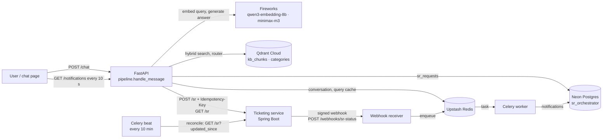

# QueryDesk — Orchestrator

The Python/FastAPI half of **QueryDesk**, an internal AI service desk for an insurance company.
It answers questions the knowledge base covers (citing the source article), turns action requests
into correctly categorised Service Requests (SRs), and notifies the user as each SR moves through
its lifecycle.

## Ownership

QueryDesk is two services, each owned by one team, behind one API contract:

| Repo | What it does | Owner |
| --- | --- | --- |
| **querydesk-orchestrator** (this repo) | Chat API, hybrid retrieval and cited answers, category router, decision layer, slot filling, ticketing client, signed-webhook receiver, Celery notifications, chat page, eval tooling | Orchestrator team |
| [querydesk-ticketing](https://github.com/querydesk-ai/querydesk-ticketing) | Spring Boot 3 / Java 21 SR service: status state machine, idempotent creation, webhook outbox with retries, UAT auto-revert | Ticketing team |
| [querydesk-docs](https://github.com/querydesk-ai/querydesk-docs) | PRD, the OpenAPI contract (`openapi.yaml`), `categories.json`, the eval set | Both teams |

The services share nothing but the contract and `categories.json`. Neither reads the other's
database.

## Results

From [docs/eval-report-v3.md](docs/eval-report-v3.md), 94 labelled messages:

| Metric | Result | PRD target |
| --- | --- | --- |
| Routing accuracy (right decision for the message) | **96%** | ≥ 90% |
| Category accuracy on SR-bound queries | **100%** | ≥ 90% |
| Action requests wrongly answered with an article | **0%** | ≤ 5% |
| Status changes notified within 1 minute | **10 of 10** (median 3.1 s) | 10 of 10 |
| p95 latency, answer path | **7.9 s** ❌ | < 3 s |

**Known limitation: latency.**
- A first-time question spends ~2.3 s embedding (Fireworks qwen3) and ~2.3 s generating, which
  puts the answer path above the 3 s target.
- A repeated message hits the Redis query cache and embeds in 30–60 ms.
- A faster local embedding model was trialled and rejected, because it routed worse
  ([docs/embedding-trial.md](docs/embedding-trial.md)). For this product, routing quality comes
  first.

## Architecture



**One message, start to finish:**

1. **Slot filling first.** If a slot-filling conversation is open, the reply fills the missing
   fields. There's no search.
2. **Status questions next.** A status question ("status of my requests") is answered from the
   ticketing service, also without a search.
3. **Otherwise, a fresh message:**
   - It's embedded once.
   - Hybrid search (dense + BM25) and the category router run at the same time.
   - A rule engine picks exactly one decision:
     - **answer**, from the retrieved chunks with citations;
     - **raise an SR**, with an idempotency key;
     - **ask for the missing fields**;
     - **escalate** to the service desk.
4. **Status changes come back asynchronously.** Each one arrives as a signed webhook, a Celery
   worker writes it once, and the chat page shows it.

Design details and the invariants that are easy to break are in [CLAUDE.md](CLAUDE.md). The
reasoning behind each change is in the [eval reports](docs/) and the day plans.

## Setup

```bash
# Requires uv: https://docs.astral.sh/uv/
uv sync                          # creates .venv (Python 3.11) from uv.lock, dev tools included

cp .env.example .env
# Fill in FIREWORKS_API_KEY and QDRANT_* at minimum; REDIS_URL, POSTGRES_DSN and WEBHOOK_SECRET
# for slot filling, SR records and notifications. TYPESAFE_API_KEY is only for scripts/jev_compare.py.
```

`.env` must sit in this directory (next to `.env.example`), not inside `src/`.

```bash
uv run scripts/check_services.py    # Qdrant / Redis / Postgres reachability
uv run scripts/migrate.py           # create/upgrade sr_requests + notifications in Neon
uv run scripts/ingest.py            # chunk, embed (dense + BM25) and index data/kb into Qdrant
uv run scripts/ingest.py --recreate # only when the collection schema or embedding model changes
```

Re-running ingestion is safe: point ids are deterministic, so chunks update in place.

## Run

The SR path needs a ticketing service. Until it is deployed, run the stand-in
(`tests/fakes/fake_ticketing.py`), which implements contract v1.1:

```bash
export WEBHOOK_SECRET=dev-secret     # the same value in all three processes

# 1. stand-in ticketing service, sending signed status webhooks to the app
STAND_IN_WEBHOOK_URL=http://127.0.0.1:8000/webhooks/sr-status \
  uv run uvicorn tests.fakes.fake_ticketing:app --port 8081

# 2. the orchestrator: chat page at http://127.0.0.1:8000/
TICKETING_BASE_URL=http://127.0.0.1:8081 uv run uvicorn querydesk.main:app --reload

# 3. the notification worker (Windows needs --pool=solo; the flags save Upstash commands)
TICKETING_BASE_URL=http://127.0.0.1:8081 uv run celery -A querydesk.worker worker \
  --pool=solo -l info --without-gossip --without-mingle --without-heartbeat

# optional: reconcile lost webhooks every 10 minutes
TICKETING_BASE_URL=http://127.0.0.1:8081 uv run celery -A querydesk.worker beat -l info
```

To play the approver, open the stand-in's Swagger at `http://127.0.0.1:8081/docs` and
`PATCH /sr/{id}/status`. The notification shows up in the chat page within ~10 s.

```bash
curl -X POST http://127.0.0.1:8000/chat -H "Content-Type: application/json" \
  -d '{"user_id":"test","query":"when is my commission credited?"}'
```

Each message gets exactly one `decision` (first match wins):

| Decision | `resolution_type` | When |
| --- | --- | --- |
| `STATUS_LOOKUP` | `MANUAL_ESCALATION` | asks about an existing request; answered from the ticketing service |
| `ANSWER` | `RAG` | not an action, top dense score ≥ `confidence_high` |
| `ANSWER_WITH_DISCLAIMER` | `RAG` | not an action, score ≥ `confidence_mid` |
| `RAISE_SR` | `AUTO_SR` | an action, router confident, all required fields present → `sr_id` |
| `COLLECT_DETAILS` | `AUTO_SR` | as above, but fields are missing → asks for them, opens a conversation |
| `ESCALATE` | `MANUAL_ESCALATION` | anything else; recorded in `sr_requests` for the desk |
| `CANCELLED` | `AUTO_SR` | "cancel" ends an open conversation |

The rules behind the decisions:

- **An action request is never answered with an article.**
- **A question the knowledge base doesn't cover escalates** with no sources and no LLM call.
- **Resending a request returns the same SR** (idempotency key), and a user with an open SR in a
  category gets that SR back instead of a second one.
- **Config rules in `data/decision_rules.json` apply last**, and they can only tighten a decision
  (force approval or escalation).

Other endpoints: `GET /health`, `GET /health/ready` (also pings Qdrant), `GET /notifications`,
`POST /notifications/read`, `POST /webhooks/sr-status` (HMAC-signed, for the ticketing service).

## Run with Docker

`compose.yaml` runs the orchestrator stack:
- `api` on port 8000;
- `worker`, the notification worker;
- `beat`, which reconciles every 10 minutes;
- a local `redis`;
- with the `stand-in` profile, the stand-in ticketing service on 8081.

Qdrant, Neon and Fireworks stay in the cloud and are read from `.env`. Redis is the local
container, not Upstash, so the demo doesn't spend the free-tier quota.

```bash
cp .env.example .env                                  # then fill it in, as in Setup
docker compose run --rm api python scripts/migrate.py # once per database
docker compose --profile stand-in up --build          # chat page at http://localhost:8000/
```

- **Play the approver** in the stand-in's Swagger at `http://localhost:8081/docs`.
- **The real ticketing service:** once it's reachable, run without the profile and set
  `DOCKER_TICKETING_BASE_URL` in `.env`.
- **The BM25 model is baked into the image**, so containers start without downloading it.

The ticketing team's deployment notes are in [docs/docker.md](docs/docker.md): which port to
proxy, and the env vars.

## WhatsApp

Users can also chat with the bot on WhatsApp, through Meta's WhatsApp Cloud API (its free test
number) or Twilio. Each user has a private one-to-one chat with the same answers, SRs and status
questions as the chat page, and gets SR updates in the same chat. It is off unless the WhatsApp
variables in `.env.example` are set. Setup, a local test with a tunnel, and the Sandbox limits are in
[docs/whatsapp.md](docs/whatsapp.md).

## Tests

The suite is fully offline: Fireworks and Jev are mocked with `respx`, Qdrant is monkeypatched,
Redis is `fakeredis`, and the ticketing stand-in runs in-process. It needs no API key and no
running services.

```bash
uv run pytest -q
uv run ruff check . && uv run ruff format --check .
```

CI runs lint, format check, the tests and a gitleaks secrets scan on every push.

## Eval

The eval set (`eval/eval_set.jsonl`, 94 labelled messages; its source of truth is
`querydesk-docs`) calibrates the thresholds and measures the decision layer against live
services:

```bash
uv run scripts/eval_run.py                  # writes eval/results/<timestamp>.jsonl
uv run scripts/eval_report.py               # docs/eval-report-latest.md + threshold proposals
uv run scripts/eval_report.py --out docs/eval-report-vN.md --title "Eval report vN"
```

The report proposes thresholds but never edits config. Change them deliberately, and record the
decision in the published report.

## Layout

```
src/querydesk/
  main.py                       # FastAPI app + lifespan (Qdrant check, BM25 warm-up)
  worker.py                     # Celery app: notify task + reconcile beat job
  core/config.py                # all settings — nothing else reads the environment
  core/errors.py                # UpstreamError family → HTTP 502
  api/routes/                   # chat, health, notifications, webhooks
  static/index.html             # the one-file chat page
  models/schemas.py             # request/response shapes, Decision, ResolutionType
  eval/                         # eval-set schema, calibration, report rendering
  services/
    pipeline.py                 # the whole /chat flow
    conversation.py             # slot-filling state in Redis
    status.py                   # status answers
    rag.py                      # retrieve() + generate() a grounded answer
    catalog.py                  # the only app-code reader of categories.json
    llm/fireworks.py            # Fireworks (LLM + embeddings)
    llm/local_embed.py          # local fastembed dense model (trialled, off by default)
    llm/jev.py                  # Jev via JevStation (offline comparison only)
    retrieval/                  # embedding entry point, query embedding + cache, Qdrant, BM25, chunking
    routing/router.py           # top-two categories + whether it's confident
    decision/                   # signals, field extraction, rule 6, the rule engine
    ticketing/client.py         # the only module that talks to the ticketing service
    notifications/              # HMAC signing, the idempotent status-change handler
    state/                      # Redis and Postgres access
tests/                          # unit/, integration/, fakes/fake_ticketing.py
migrations/                     # plain SQL, applied in order by scripts/migrate.py
data/                           # categories.json, decision_rules.json, kb/ (11 articles)
eval/eval_set.jsonl             # 94 labelled messages
docs/                           # task board, day plans, eval reports, design notes
scripts/                        # ingest, eval, migrate, service checks, Jev and latency comparisons
```
